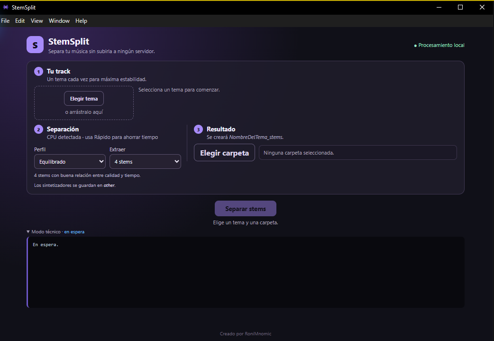

# StemSplit

**Version 0.3.1 · Windows**

StemSplit separates music tracks into individual stems on your Windows computer. Audio is processed locally, without uploading your tracks to the cloud.

[Download the Windows installer (0.3.1)](https://github.com/Mnomik/StemSplit/releases/download/v0.3.1/StemSplit-Setup-0.3.1.exe) · [Release notes](https://github.com/Mnomik/StemSplit/releases/tag/v0.3.1)

Run the installer to install StemSplit or update an existing installation. It includes Electron, Python and Demucs. The first separation may need an internet connection to download the model weights.

Version 0.3.1 fixes audio preview loading and adds compact **ES** and **EN** controls for the main interface. Some dialogs and engine messages remain in Spanish.



## Run version 0.3.1 from source on Windows

Install Node.js with npm, Python 3.12 with the Windows Python launcher, and Git. For audio formats that need FFmpeg, install FFmpeg and make sure `ffmpeg` and `ffprobe` are on your PATH. Run the following in PowerShell:

```powershell
git clone https://github.com/Mnomik/StemSplit.git
cd StemSplit
py -3.12 -m venv .venv
.\.venv\Scripts\python.exe -m pip install "demucs==4.1.0"
npm.cmd install
npm.cmd start
```

If Demucs is already installed, you can skip the two Python commands and set `$env:STEM_LOCAL_PYTHON` to the full path of that environment's `python.exe` before starting StemSplit. The first separation may need internet access to download model weights. Your audio is processed on your computer.

Choose a track, select a separation profile and an output folder, then click **Separate stems**. Each result is saved in a folder named after the track.

## License

StemSplit is licensed under the GNU General Public License, version 3 or any later version (`GPL-3.0-or-later`). See [LICENSE](LICENSE) for the full text.
